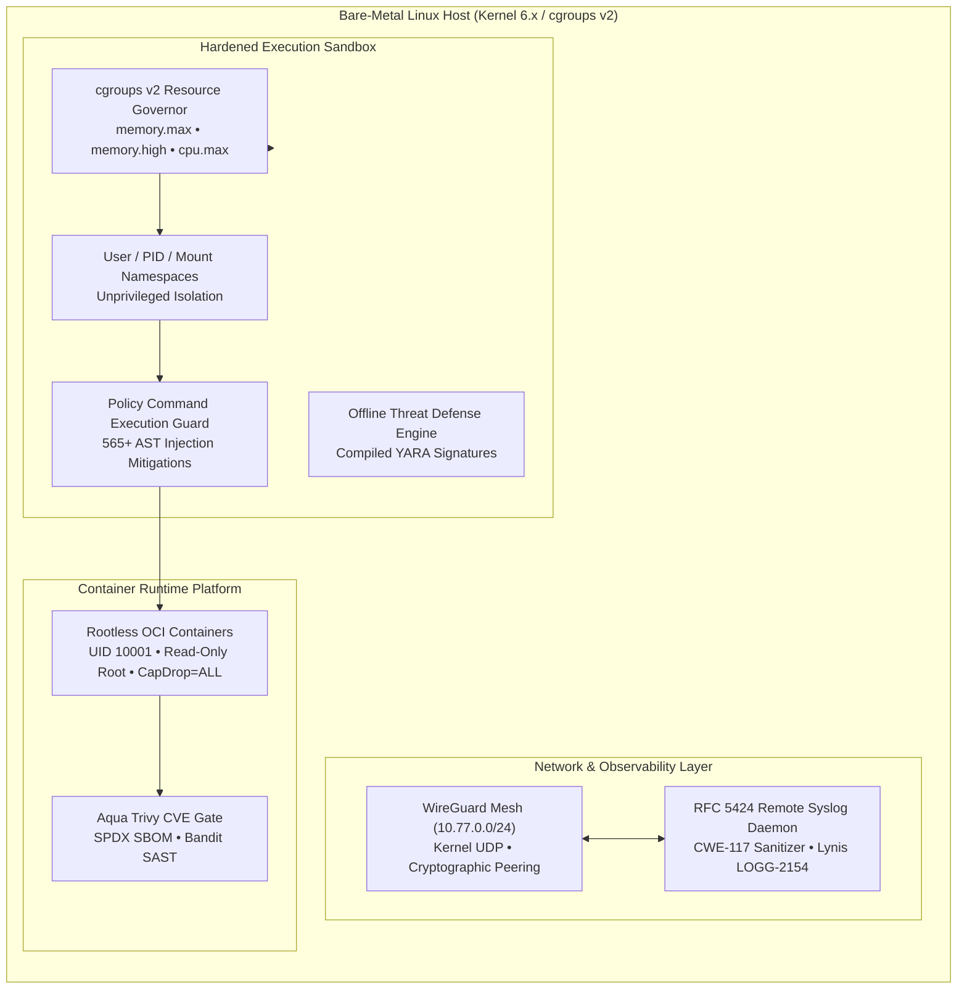

# Ethan Kilmer

### Senior / Staff Systems & DevSecOps Engineer | Distributed Systems & Linux Kernel Hardening
**Defense-in-Depth Infrastructure • Kernel Resource Isolation • Zero-Trust Execution • Deterministic Runtimes**

---

## Executive Engineering Summary

Staff Systems and DevSecOps Engineer specializing in defense-in-depth infrastructure, deterministic air-gapped runtimes, OS-level resource isolation (cgroups v2, Linux namespaces), and container security hardening. Proven track record engineering production-grade distributed architectures with **zero unvetted runtime dependencies**, **100% automated test verification**, and strict least-privilege boundary enforcement across bare-metal Linux (Arch, Fedora, Debian/Ubuntu) and macOS environments.

---

## Core Architecture & Systems Highlights

### 🛡️ Production DevSecOps Container Platform
- **Multi-Stage Hardened OCI Containers:** Engineered minimal multi-stage container architectures executing under dedicated unprivileged non-root service accounts (`UID 10001:GID 10001`) with read-only root filesystems and explicit Linux capabilities drops (`--cap-drop=ALL`).
- **POSIX Signal Governance:** Implemented deterministic sub-process life-cycle management handling `SIGTERM` / `SIGINT` graceful socket draining and teardown with zero orphaned zombie processes.
- **Automated CVE Gating & SAST:** Production CI/CD pipelines integrated with **Aqua Security Trivy** (zero Critical/High CVE threshold), **Bandit** AST security scanning, and automated **SPDX / CycloneDX Software Bill of Materials (SBOM)** artifact generation.

### 🌐 Distributed 3-Node WireGuard Mesh & Remote Syslog Daemon
- **Private Kernel Mesh Infrastructure:** Automated topology provisioning over a dedicated RFC 1918 `10.77.0.0/24` subnet across heterogeneous host architectures (Linux x86_64, macOS Apple Silicon) with cryptographic pubkey exchange, CIDR IP allowlisting, and persistent keepalive tunnels.
- **RFC 5424 / RFC 3164 Remote Syslog Daemon:** High-throughput local syslog daemon satisfying **Lynis LOGG-2154** enterprise logging compliance, featuring strict CIDR allowlisting, socket isolation, and automatic rotation.
- **Bidirectional Log Sanitization (CWE-117):** Implemented stream-level log scrubbing eliminating newline injection (CRLF), ANSI escape sequence tampering, and terminal control character exploitation.

### 🔍 Autonomous Offline Threat Defense Engine
- **Air-Gapped Static Heuristic Analysis:** Zero-network-reliance malware and anomalous payload detection engine leveraging compiled **YARA** rulesets.
- **Byte-Level Pattern Matching:** High-performance scanning engine inspecting PE/ELF binary headers, shell script injections, Shannon entropy variance, and embedded shellcode vectors.
- **Cryptographic Signature & Integrity Auditing:** Automated SHA-256 state tracking, drift detection, and tamper verification across critical host binaries and configuration baselines.

### 🔒 Linux Privilege Escalation Auditor & Host Hardening Framework
- **Least-Privilege Security Governance:** Custom audit framework parsing `/etc/sudoers` AST grammars, detecting wildcards, unvalidated `NOPASSWD` executions, and insecure environment delegations.
- **Systemd Attack Surface Minimization:** Automated auditing via `systemd-analyze security` mapping service isolation metrics (`PrivateTmp`, `ProtectSystem`, `ProtectHome`, `NoNewPrivileges`, `RestrictSUIDSGID`).
- **Filesystem Permission Guard:** Continuous detection of world-writable paths (`find -perm -0002`), SUID/SGID anomalies, and unauthorized root execution paths.

### ⚙️ Linux cgroup v2 & User Namespace Sandbox Governor
- **Deterministic Resource Containment:** Kernel-level process constraints using cgroups v2 hierarchies (`memory.max`, `memory.high`, `cpu.max`, `pids.max`) preventing memory saturation and Out-Of-Memory (OOM) host lockups.
- **Ephemeral Namespaced Sandboxing:** Isolates untrusted workload execution inside unprivileged user, mount, and PID namespaces with loopback network isolation (`unshare -U -p -m -n`).
- **Thermal & OOM Throttle Guards:** Real-time procfs monitoring engine throttling long-running compute workloads upon hardware thermal thresholds (90°C GPU / 99°C CPU) with safe backoff.

### 🛡️ Policy Command Execution Guard & AST Zero-Trust Filter
- **Lexical AST Inspection:** Pure zero-dependency shell parser validating execution trees against strict whitelists prior to subshell spawning.
- **565+ Verified Adversarial Injection Mitigations:** Hardened resistance against arbitrary parameter expansion, backtick evaluation, nested command substitution (`$(...)`), pipeline hijacking, and file descriptor redirection attacks.
- **POSIX Compliant:** Zero runtime interpreter overhead; audited against ShellCheck and rigorous behavioral test suites.

### 🏥 PointClickCare (PCC) Healthcare Shift Automation & OpenXML Engine
- **Clinical Data Transformation Pipeline:** High-reliability ETL automation ingesting asynchronous clinical staffing streams, normalizing shift matrices, and enforcing HIPAA data privacy controls.
- **Deterministic OpenXML Document Generator:** Direct byte-level Office Open XML (`.docx` / `.xlsx`) packaging without COM/Office dependencies, featuring schema-valid XML serialization, deterministic table styling, and dynamic run formatting.

### 📐 Bounded Mathematical Evaluator & Linear Algebra Engine
- **IEEE 754-Compliant Matrix Runtime:** Pure zero-external-dependency linear algebra engine executing arbitrary-dimension matrix operations, LU decomposition, and determinants.
- **Deterministic Float Geometry:** Bounded error propagation for vector transformations, affine mapping, and coordinate space projections designed for safety-critical simulations.

### 🎮 Interactive Canvas Engine & 8 Educational STEM Simulators
- **High-Performance 2D Canvas Engine:** Custom rendering pipeline featuring spatial hashing, discrete bounding-box collision detection, hierarchical drag-and-drop state machines, and event dispatchers.
- **8 Interactive Physics & Systems Simulators:** Real-time interactive engines modeling Newtonian kinematics, celestial orbits, digital logic gate propagation, circuit analysis, and structural mechanics.

---

## Comprehensive Technical Skills Matrix

| Domain | Core Technologies, Standards & Tooling |
| :--- | :--- |
| **Systems & OS Internals** | Linux (Arch, Fedora, Debian/Ubuntu, RHEL), macOS (Darwin), systemd init, cgroups v2, Linux Namespaces (PID, Mount, Net, User), procfs/sysfs introspection, POSIX standards, SysV IPC |
| **Security & DevSecOps** | YARA static rulesets, Aqua Security Trivy, Bandit SAST, ShellCheck, WireGuard Mesh, Shannon Entropy Secret Detection, Principle of Least Privilege, CWE-117 mitigation, CIS Benchmarks, SUID/SGID auditing |
| **Infrastructure & Containers** | Docker (Rootless, Multi-stage, Distroless), OCI compliance, GitHub Actions (Hardened CI/CD DAGs), WireGuard (Kernel/Userspace), Remote Syslog (RFC 5424/3164), QEMU/KVM, Linux bridge networking, iptables/nftables |
| **Languages & Runtimes** | Python (3.10–3.13, stdlib-first architecture, zero external runtime dependencies), Bash / POSIX Shell, Rust (systems tooling, CLI binaries), C/C++ (systems libraries, uinput), JavaScript / TypeScript (Node.js, Canvas API), SQL / SQLite |
| **Data & Serialization** | OpenXML (ISO/IEC 29500 / DOCX / XLSX), JSON Schema, CycloneDX / SPDX SBOM, YAML, Protocol Buffers, pure IEEE 754 floating-point algorithms |
| **Reliability & Verification** | Deterministic State Engines, 100% Automated Test Suites, Fault Injection, Thermal Telemetry Guards, Memory Safety & OOM Prevention, Strict Regression Baselines |

---

## Architectural Systems Topology

---

## Engineering Standards & Quality Commitments

- **Zero Unvetted Runtime Dependencies:** Minimizing supply-chain attack surfaces by leveraging language standard libraries and verified static compilation.
- **100% Pass Rate Across Test Suites:** Every system backed by automated unit and integration tests with deterministic mocks.
- **Defensive Execution:** Comprehensive signal handling, atomic file operations, OOM guarding, and resource containment.
- **Air-Gapped Operational Resilience:** Complete functionality without reliance on third-party cloud infrastructure or unverified dynamic registries.

---

## Featured Systems & Repositories Showcase

| Repository | Architecture & Technical Implementation | Engineering Domain |
| :--- | :--- | :--- |
| **[Tiny Dancer](https://github.com/Ethan-da-Tech-Wizard/tiny_dancer)** | Autonomous local execution agent environment with native tool contracts, hardened execution boundaries, and licensing governance. | Distributed Agent Runtimes |
| **[DSCE](https://github.com/Ethan-da-Tech-Wizard/DSCE)** | Deterministic Semantic Computation Engine; spreading-activation reasoning engine with formal state graphs in Python and Rust. | Deterministic Reasoning |
| **[SpaceMap](https://github.com/Ethan-da-Tech-Wizard/space_map)** | High-throughput concurrent filesystem scanner with directory metadata aggregation and interactive treemap layout algorithms. | Systems Performance & Storage |
| **[CodeLens Local](https://github.com/Ethan-da-Tech-Wizard/soft_DNA)** | Air-gapped static codebase analysis platform indexing AST structures, symbol resolution, and architecture drift metrics. | Static Code Analysis |
| **[Extreme Calculator](https://github.com/Ethan-da-Tech-Wizard/EHXTREAM_CALC)** | Standalone IEEE 754-compliant numerical evaluation engine with arbitrary-dimension matrix algebra and zero external runtime dependencies. | Numerical Systems |
| **[What’s Running?](https://github.com/Ethan-da-Tech-Wizard/whats_running)** | Real-time Linux kernel process introspection utility querying `/proc` and network sockets for listening port mapping. | Linux Host Observability |
| **[VMBby](https://github.com/Ethan-da-Tech-Wizard/vmbby)** | Rust-based virtual machine supervisor managing KVM/QEMU guest lifecycle and display socket routing on Wayland. | Systems Virtualization |
| **[WireGuard VPN Tools](https://github.com/Ethan-da-Tech-Wizard/vpn)** | Hardened cryptographic mesh setup scripts, CIDR IP allocation templates, and automated interface lifecycles. | Network Infrastructure |
| **[Universal JSON Schema Converter](https://github.com/Ethan-da-Tech-Wizard/json_schema_converter)** | High-assurance schema inference engine transforming JSON, CSV, XML, and YAML into validated JSON Schema specifications. | Data Serialization |
| **[Fort Builder](https://github.com/Ethan-da-Tech-Wizard/fortz)** | Custom 2D HTML5 Canvas rendering engine with spatial indexing, object collision primitives, and reactive state stores. | Interactive Canvas Engines |
| **[The Sacred Tech](https://github.com/Ethan-da-Tech-Wizard/ult)** | Systems and networking educational simulation platform incorporating POSIX command evaluation, SQL parsing, and runtime sandboxing. | Interactive Systems Education |
| **[Archi](https://github.com/Ethan-da-Tech-Wizard/archi)** | Infinite-canvas visual architecture modeling workspace with native vector serialization and connector routing algorithms. | Systems Architecture Tooling |
| **[Access Lab](https://github.com/Ethan-da-Tech-Wizard/enki)** | Multi-tenant access control and entitlement management system with role-based policies and audit logging. | Identity & Access Governance |
| **[Relayworks](https://github.com/Ethan-da-Tech-Wizard/free_intro)** | Enterprise workflow orchestration prototype automating data ingest, OpenXML report generation, and status dispatch. | Workflow Automation |

---

**[GitHub](https://github.com/Ethan-da-Tech-Wizard)** • **[Portfolio Docs](docs/FILE_GUIDE.md)** • **[License](LICENSE)**

*Engineering systems that are verifiable, bounded, secure by default, and built to survive production.*

